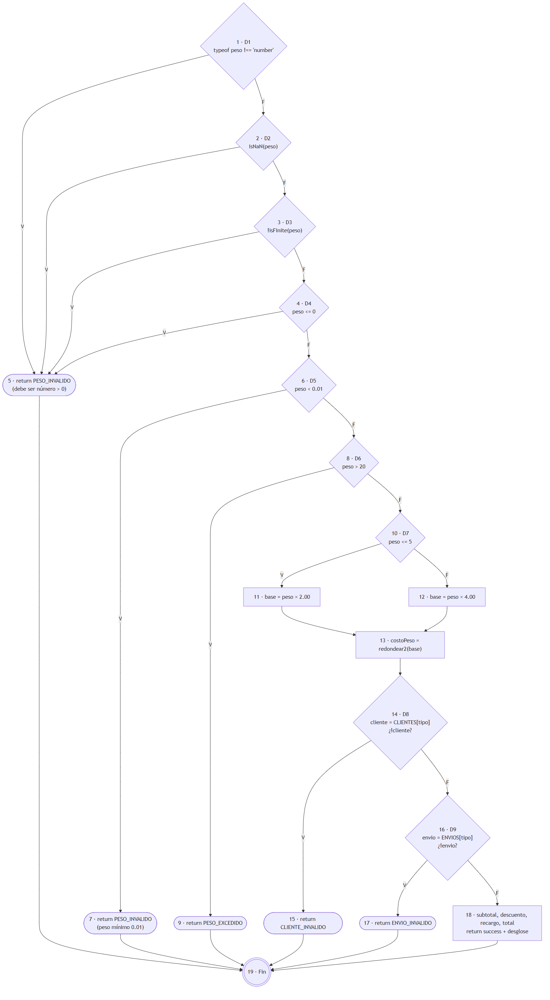

# 2. Plan de Pruebas de Caja Blanca (QA + Backend)

**Algoritmo principal analizado:** `calcularTarifa(peso, tipoCliente, tipoEnvio)` en `backend/src/Codigo.js` (líneas 855–898). Es la función que implementa BR-01 a BR-04 y es pura (no toca la base de datos), por lo que se puede analizar y probar de forma aislada.

## 2.1 Código analizado

```js
function calcularTarifa(peso, tipoCliente, tipoEnvio) {
  if (typeof peso !== "number" || isNaN(peso) || !isFinite(peso) || peso <= 0) {   // D1, D2, D3, D4
    return { success: false, codigo: "PESO_INVALIDO", ... };                        // nodo 5
  }
  if (peso < CONFIG.PESO_MIN_KG) {                                                  // D5
    return { success: false, codigo: "PESO_INVALIDO", ... };                        // nodo 7
  }
  if (peso > CONFIG.PESO_MAX_KG) {                                                  // D6
    return { success: false, codigo: "PESO_EXCEDIDO", ... };                        // nodo 9
  }

  const costoPeso = redondear2(
    peso <= CONFIG.LIMITE_TRAMO_LIVIANO_KG                                          // D7
      ? peso * CONFIG.COSTO_KG_LIVIANO                                              // nodo 11
      : peso * CONFIG.COSTO_KG_PESADO                                               // nodo 12
  );                                                                                // nodo 13

  const cliente = CONFIG.CLIENTES[String(tipoCliente).toUpperCase()];
  if (!cliente) { return { ..., codigo: "CLIENTE_INVALIDO", ... }; }               // D8, nodo 15
  const envio = CONFIG.ENVIOS[String(tipoEnvio).toUpperCase()];
  if (!envio) { return { ..., codigo: "ENVIO_INVALIDO", ... }; }                   // D9, nodo 17

  const subtotal = redondear2(CONFIG.TARIFA_BASE + costoPeso);                      // nodo 18
  const montoDescuento = redondear2(subtotal * cliente.descuento);
  const subtotalConDescuento = redondear2(subtotal - montoDescuento);
  const montoRecargo = redondear2(subtotalConDescuento * envio.recargo);
  const totalFinal = redondear2(subtotalConDescuento + montoRecargo);
  return { success: true, desglose: { ... } };
}
```

**Criterio para armar el grafo:** cada condición atómica es un nodo de decisión propio. El `if` de la línea 856 une cuatro condiciones con `||` y, por la evaluación en cortocircuito, equivale a cuatro decisiones encadenadas (D1 a D4).

## 2.2 Grafo de Flujo de Control (CFG)



Fuente editable: `pruebas/caja-blanca/cfg/calcularTarifa.mmd` (Mermaid). Rombos = decisiones; rectángulos = bloques de sentencias; óvalos = `return`.

| Nodo | Contenido |
|---|---|
| 1 | D1: `typeof peso !== "number"` |
| 2 | D2: `isNaN(peso)` |
| 3 | D3: `!isFinite(peso)` |
| 4 | D4: `peso <= 0` |
| 5 | `return PESO_INVALIDO` (debe ser un número mayor a 0) |
| 6 | D5: `peso < PESO_MIN_KG` (0.01) |
| 7 | `return PESO_INVALIDO` (peso mínimo) |
| 8 | D6: `peso > PESO_MAX_KG` (20) |
| 9 | `return PESO_EXCEDIDO` |
| 10 | D7: `peso <= LIMITE_TRAMO_LIVIANO_KG` (5) |
| 11 | base = `peso × 2.00` |
| 12 | base = `peso × 4.00` |
| 13 | `costoPeso = redondear2(base)` |
| 14 | `cliente = CLIENTES[tipo]`; D8: `!cliente` |
| 15 | `return CLIENTE_INVALIDO` |
| 16 | `envio = ENVIOS[tipo]`; D9: `!envio` |
| 17 | `return ENVIO_INVALIDO` |
| 18 | subtotal, descuento, recargo, total; `return success` |
| 19 | Fin |

Aristas (V = verdadero, F = falso): 1→5 (V), 1→2 (F), 2→5 (V), 2→3 (F), 3→5 (V), 3→4 (F), 4→5 (V), 4→6 (F), 6→7 (V), 6→8 (F), 8→9 (V), 8→10 (F), 10→11 (V), 10→12 (F), 11→13, 12→13, 13→14, 14→15 (V), 14→16 (F), 16→17 (V), 16→18 (F), y 5, 7, 9, 15, 17 y 18 → 19.

## 2.3 Complejidad ciclomática V(G), paso a paso

Se calcula por los tres métodos y deben coincidir.

**Método 1: aristas y nodos, V(G) = E − N + 2P**
- Nodos: N = 19.
- Aristas: E = 8 (decisiones D1–D4) + 1 (5→19) + 2 (D5) + 1 (7→19) + 2 (D6) + 1 (9→19) + 2 (D7) + 2 (11→13, 12→13) + 1 (13→14) + 2 (D8) + 1 (15→19) + 2 (D9) + 1 (17→19) + 1 (18→19) = **27**.
- Componentes conexas: P = 1.
- V(G) = 27 − 19 + 2·1 = **10**.

**Método 2: nodos de decisión, V(G) = D + 1**
- Decisiones: D1, D2, D3, D4, D5, D6, D7, D8, D9 → D = 9.
- V(G) = 9 + 1 = **10**.

**Método 3: regiones del grafo**
- El grafo plano tiene 9 regiones cerradas más la región exterior → **10**.

**V(G) = 10** → hay **10 caminos linealmente independientes**, que es el mínimo de casos para recorrer todas las aristas.

> Si se contara cada `if` compuesto como una sola decisión (sin separar los `||`), saldría V(G) = 7. Se usa el criterio de condición atómica (V(G) = 10) porque es el que obliga a probar cada condición por separado.

Interpretación: con V(G) entre 1 y 10 la función se considera de **riesgo bajo / simple**, está en el límite superior de ese rango y es fácil de probar por completo.

## 2.4 Caminos independientes y casos de prueba

Camino base: C7 (flujo normal, retorna éxito). Cada camino siguiente cambia **una sola decisión** respecto al camino base o a uno anterior.

| ID | Camino (nodos) | Decisión que cambia | Dato de prueba | Resultado esperado | Estado |
|---|---|---|---|---|---|
| C1 | 1 → 5 → 19 | D1 = V | `peso = "5"` (texto) | `PESO_INVALIDO` | Pasa |
| C2 | 1 → 2 → 5 → 19 | D2 = V | `peso = NaN` | `PESO_INVALIDO` | Pasa |
| C3 | 1 → 2 → 3 → 5 → 19 | D3 = V | `peso = Infinity` | `PESO_INVALIDO` | Pasa |
| C4 | 1 → 2 → 3 → 4 → 5 → 19 | D4 = V | `peso = 0` | `PESO_INVALIDO` | Pasa |
| C5 | 1 → 2 → 3 → 4 → 6 → 7 → 19 | D5 = V | `peso = 0.005` | `PESO_INVALIDO` | Pasa |
| C6 | 1 → 2 → 3 → 4 → 6 → 8 → 9 → 19 | D6 = V | `peso = 20.01` | `PESO_EXCEDIDO` | Pasa |
| **C7** | 1 → 2 → 3 → 4 → 6 → 8 → 10 → 11 → 13 → 14 → 16 → 18 → 19 | (camino base) | `5, NUEVO, ESTANDAR` | éxito, total **15.00** | Pasa |
| C8 | …→ 8 → 10 → **12** → 13 → 14 → 16 → 18 → 19 | D7 = F | `10, NUEVO, ESTANDAR` | éxito, total **45.00** | Pasa |
| C9 | …→ 10 → 11 → 13 → 14 → **15** → 19 | D8 = V | `5, "XYZ", ESTANDAR` | `CLIENTE_INVALIDO` | Pasa |
| C10 | …→ 14 → 16 → **17** → 19 | D9 = V | `5, NUEVO, "AEREO"` | `ENVIO_INVALIDO` | Pasa |

Automatización: `backend/tests/unitarias/calcularTarifa.caminos.test.js`, un caso por camino; además verifica que haya exactamente 10 caminos.

### Cobertura de aristas

El camino base C7 recorre las 12 aristas del flujo normal; C1–C6, C8, C9 y C10 aportan cada uno la arista que C7 no toca. Con los 10 caminos se recorren **las 27 aristas (100 % de cobertura de aristas/ramas del CFG)** y todos los nodos (100 % de sentencias).

### Casos adicionales sobre las condiciones de frontera

Las comparaciones estrictas se verifican en el mismo archivo:

| Caso | Decisión | Qué comprueba |
|---|---|---|
| `0.01` se acepta | D5 (`<` estricto) | el mínimo exacto no se rechaza |
| `20` se acepta | D6 (`>` estricto) | el máximo exacto no se rechaza |
| `5` usa $2/kg | D7 (`<=`) | el límite del tramo liviano pertenece al tramo $2 |
| `"vip"`, `"express"` | D8, D9 | el tipo se normaliza a mayúsculas |

## 2.5 Verificación de la suite (mutación manual)

Para comprobar que las pruebas detectan errores reales, se introdujeron fallas a propósito en `calcularTarifa` y se confirmó que la suite falla; después se restauró el código.

| Falla inyectada | Pruebas que fallan |
|---|---|
| `peso <= 5` cambiado a `peso < 5` | 6 |
| `peso > 20` cambiado a `peso >= 20` | 6 |
| Descuento VIP 20 % cambiado a 25 % | 8 |
| Recargo EXPRESS 25 % cambiado a 20 % | 8 |
| Tarifa base $5.00 cambiada a $6.00 | 27 |
| Peso mínimo 0.01 cambiado a 0.02 | 7 |

Las 6 fallas fueron detectadas (6 de 6).
