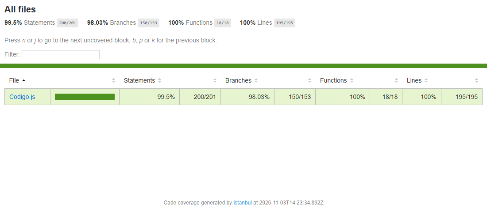

# 3. Reporte de Cobertura (Code Coverage)

Mínimo requerido por el enunciado: **85 % de cobertura de líneas y de ramas**.

## 3.1 Resultado

Ejecución del 2026-11-03 con Jest (`cd backend && npm run coverage`): **144 pruebas, 6 archivos de prueba, todas pasan**.

| Métrica | Cubierto | Total | Porcentaje | Mínimo | Resultado |
|---|---|---|---|---|---|
| **Líneas** | 195 | 195 | **100 %** | 85 % | Cumple |
| **Ramas** | 150 | 153 | **98.03 %** | 85 % | Cumple |
| Sentencias | 200 | 201 | 99.5 % | — | — |
| Funciones | 18 | 18 | 100 % | — | — |

Captura del reporte: `pruebas/cobertura/captura-cobertura-resumen.png`



Salida de consola completa: `pruebas/cobertura/salida-jest.txt`. Reporte navegable (HTML, línea por línea): `pruebas/cobertura/reporte/lcov-report/index.html`.

El umbral está **forzado en la configuración** (`backend/jest.config.js`, `coverageThreshold`): si la cobertura de líneas o de ramas baja de 85 %, el comando falla.

## 3.2 Alcance medido

- **Archivo medido:** `backend/src/Codigo.js`, que contiene las reglas de negocio (BR-01 a BR-04 en `calcularTarifa`), la validación de entradas, el enrutamiento de la API (`doGet`, `doPost`), el asistente de IA y los límites de uso.
- **No medidos:** `Login.js` (autenticación) y `Supabase.js` (acceso a datos). Dependen de servicios externos (base de datos y correo) y no implementan reglas de cotización; quedan fuera del alcance de esta medición.
- El código fuente es **idéntico** al de Apps Script: no se modificó para poder probarlo. El transformador de Jest (`backend/tests/helpers/cargadorAppsScript.js`) solo añade un `module.exports` en memoria durante las pruebas.
- Los servicios de Google (`ContentService`, `CacheService`, `LockService`, `UrlFetchApp`, `PropertiesService`) y Gemini están **simulados**: las pruebas no hacen llamadas reales ni consumen cuota.

## 3.3 Análisis

**Qué cubre cada grupo de pruebas**

| Archivo de prueba | Cubre |
|---|---|
| `tests/unitarias/calcularTarifa.caminos.test.js` | Los 10 caminos independientes de `calcularTarifa` (caja blanca) |
| `tests/unitarias/calcularTarifa.cajaNegra.test.js` | E.P., BVA de Peso y Monto, y las 6 reglas de la tabla de decisión |
| `tests/api/cotizacion.api.test.js` | `doGet`, `doPost`, `procesarCotizacion`: contrato, validaciones, registro y errores internos |
| `tests/api/chat.test.js` | `atendedorChatIA` y `llamarGeminiAPI`: reintentos, cuota, bloqueos de seguridad, respuestas malformadas |
| `tests/unitarias/utilidades.test.js` | `redondear2`, `normalizarSesionId`, `responderJSON`, `verificarRateLimit`, `seleccionarChisteUnico` |
| `tests/unitarias/herramientasDesarrollo.test.js` | Funciones de uso manual (`verMiSnapshot`, `probarCalcularTarifa`, `probarHistorial`) |

**Código no cubierto**

- Líneas 938–941 (3 ramas y 1 sentencia): la rama de fallo (`❌`) dentro de `probarCalcularTarifa`, una herramienta manual del editor. Solo se ejecuta si el cálculo estuviera mal, por lo que con el código correcto no puede alcanzarse. No es lógica de negocio.

**Calidad de las pruebas, más allá del porcentaje**

Una cobertura alta no garantiza que las pruebas detecten errores. Para comprobarlo se inyectaron 6 fallas deliberadas en `calcularTarifa` (límites de tramo, porcentajes, tarifa base, peso mínimo) y la suite las detectó **todas** (ver §2.5). Además, los resultados esperados de las pruebas de caja negra se calcularon a mano desde las reglas, no a partir de la salida del código.

**Limitaciones**

- Las pruebas no verifican la integración real con Supabase, Gemini ni el correo; esas piezas se simulan.
- La cobertura mide qué código se ejecuta, no que las reglas sean las correctas: la corrección de las reglas la verifican las pruebas de caja negra (§1) contra el enunciado.

## 3.4 Cómo reproducirlo

```
cd backend
npm install
npm run coverage        # 144 pruebas + reporte; falla si líneas o ramas < 85 %
```

El reporte HTML se genera en `pruebas/cobertura/reporte/lcov-report/index.html`.
